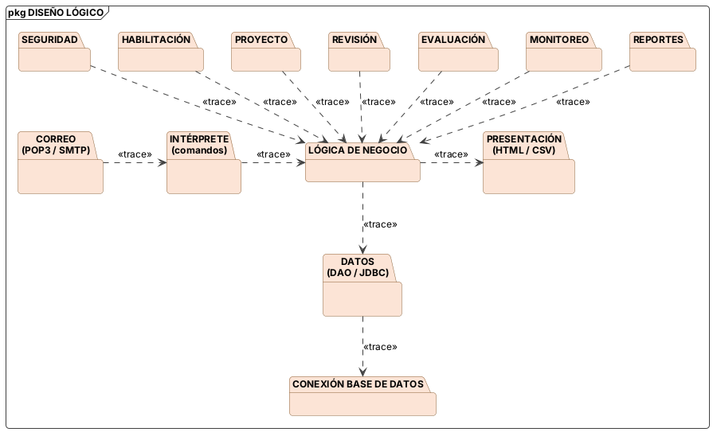
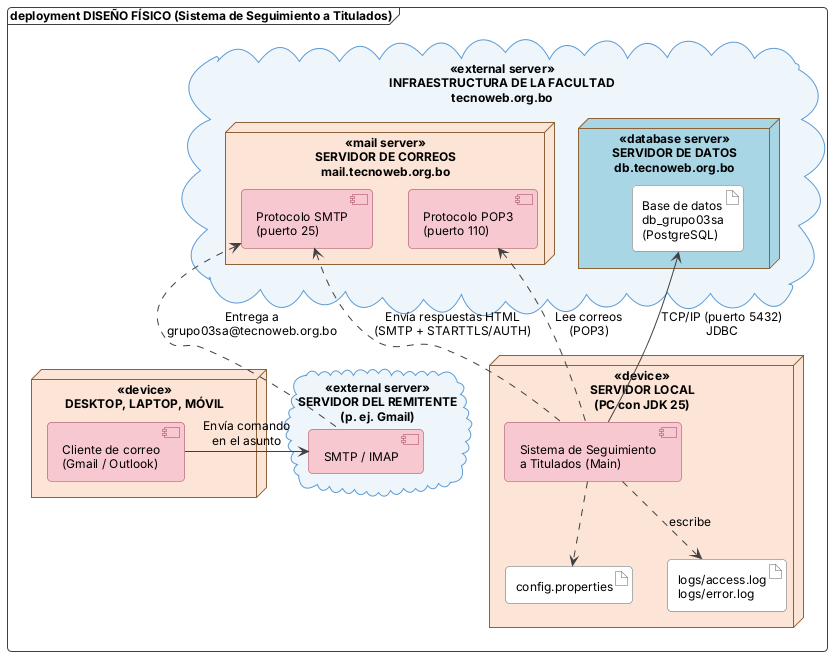
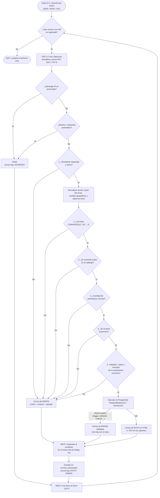
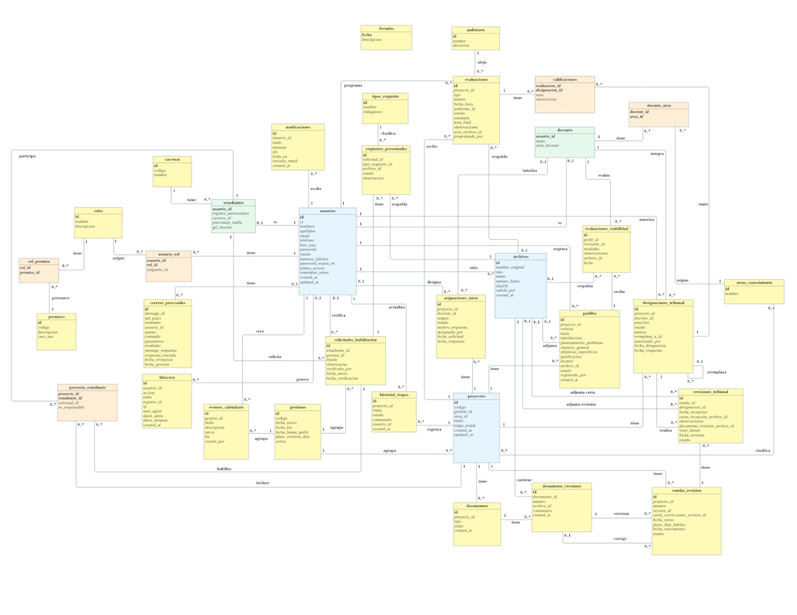
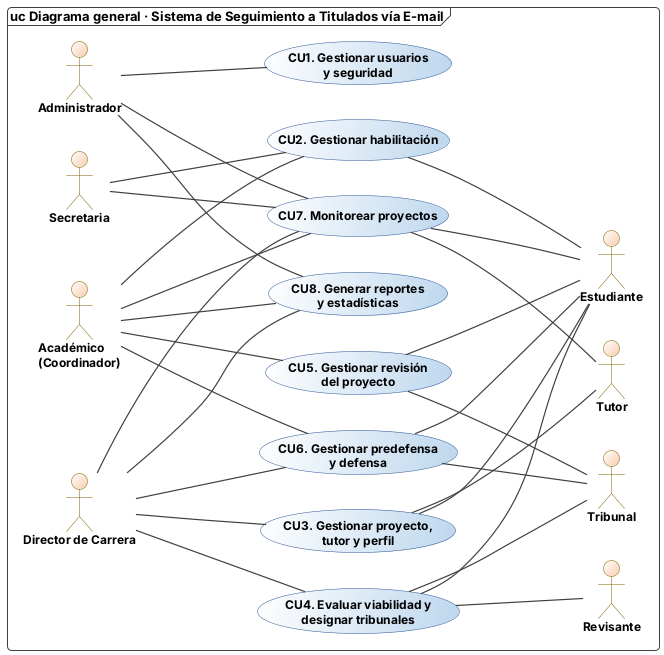

# Sistema de Seguimiento a Titulados vía E-mail

**INF513-SA Tecnología Web · Gestión 2-2026 · Grupo 03 SA**
Universidad Autónoma Gabriel René Moreno (UAGRM) · Facultad de Ingeniería en Ciencias de la Computación y Telecomunicaciones (FICCT)

> **Proyecto #1:** Sistema de Automatización y Procesamiento de Datos Basado en Correo Electrónico (*Email-Driven Architecture*).

Este sistema gestiona el proceso de titulación por proyecto de grado **únicamente por correo electrónico**: habilitación, tutor, perfil, viabilidad, tribunales, revisiones, predefensa, defensa y reportes. El usuario envía un correo a **`grupo03sa@tecnoweb.org.bo`** con un comando en el **asunto**. El sistema lo lee por POP3, lo valida, lo ejecuta sobre PostgreSQL y responde por SMTP con un correo HTML que confirma el éxito o detalla el error.

```
COMANDO["parámetro1","parámetro2",...]        Ejemplo:  LISPRO["*"]
```

| | |
|---|---|
| Casos de uso | 8 |
| Comandos | 75 |
| Roles | 8 (administrador, director, académico, secretaria, tutor, revisante, tribunal, estudiante) |
| Tablas | 34 + 2 triggers, 1 función y 1 vista |
| Lenguaje | Java 21+ (desarrollado con Java 25), Maven, sockets TCP puros (sin librerías de correo) |

## Integrantes

| Nombre | Registro |
|---|---|
| Arandia Rioja Pablo Joaquin | 218003374 |
| Campos Villarroel Ronald Junior | 222007737 |
| Claros Mamani Paul Andrés | 221044221 |

Docente: M. Sc. Ing. Evans Balcázar Veizaga

---

## Contenido

1. [Arquitectura](#arquitectura)
2. [Diagrama de flujo del analizador de correos](#diagrama-de-flujo-del-analizador-de-correos)
3. [Estructura del proyecto](#estructura-del-proyecto)
4. [Base de datos](#base-de-datos)
5. [Instalación y configuración](#instalación-y-configuración)
6. [Uso y comandos](#uso-y-comandos)
7. [Logs](#logs)
8. [Seguridad](#seguridad)
9. [Pruebas](#pruebas)
10. [Documentación y diagramas](#documentación-y-diagramas)

---

## Arquitectura

El sistema sigue una **arquitectura Email-Driven en capas**. Cada capa solo usa las de abajo:

| Capa (paquete) | Clases principales | Responsabilidad |
|---|---|---|
| `correo` | `MonitorBuzon`, `ClientePOP3`, `ClienteSMTP`, `ParserCorreo` | Lee el buzón por POP3 cada 10 s, decodifica el mensaje y envía la respuesta por SMTP |
| `interprete` | `AnalizadorAsunto`, `CatalogoComandos`, `Despachador` | Analiza el asunto, valida comando, parámetros y permiso, y llama a la acción |
| `negocio` | `NUsuario`, `NHabilitacion`, `NProyecto`, `NTribunal`, `NRevision`, `NEvaluacion`, `NMonitoreo`, `NReporte`, `NSeguridad`, `NNotificacion` | Reglas de negocio de cada caso de uso |
| `datos` | `ConexionBD`, `Transaccion`, `DUsuario` … `DReporte` (17 clases D) | Acceso a PostgreSQL con JDBC y sentencias preparadas |
| `presentacion` | `RespuestaHtml`, `TablaHtml`, `AyudaHtml`, `Csv` | Arma el HTML de las respuestas y los adjuntos CSV |
| `util` / `config` | `Validador`, `Contrasenas`, `Registro`, `Config` | Validación de tipos, bcrypt, logs y configuración |



**Despliegue.** El programa corre en una PC con Java y se conecta a la infraestructura de la facultad:

| Servicio | Servidor | Puerto |
|---|---|---|
| POP3 (leer el buzón `grupo03sa`) | `mail.tecnoweb.org.bo` | 110 |
| SMTP (enviar respuestas; EHLO, STARTTLS y AUTH si el servidor los ofrece) | `mail.tecnoweb.org.bo` | 25 |
| PostgreSQL (`db_grupo03sa`) | `db.tecnoweb.org.bo` | 5432 |



---

## Diagrama de flujo del analizador de correos

Ciclo que ejecuta `MonitorBuzon` cada `mail.intervalo.segundos` (10 s), con las validaciones del `Despachador` en el orden real del código:



Si falla la conexión POP3, SMTP o la base de datos, el error y su traza se anotan en `logs/error.log`, y el monitor reintenta en el próximo ciclo sin detenerse.

---

## Estructura del proyecto

```
SistemaSeguimientoTituladosEmailGrupo03SA/
├── pom.xml
├── README.md
├── docs/
│   ├── img/          imágenes usadas en este README
│   └── diagramas/    código PlantUML (.puml) de todos los diagramas UML del informe
├── logs/             access.log y error.log (se crean al ejecutar; no se suben)
└── src/
    ├── main/java/org/example/
    │   ├── Main.java              punto de entrada
    │   ├── config/                Config
    │   ├── correo/                MonitorBuzon, ClientePOP3, ClienteSMTP, ParserCorreo, Correo, Adjunto
    │   ├── interprete/            AnalizadorAsunto, CatalogoComandos, Despachador, Contexto, Respuesta…
    │   ├── negocio/               NSeguridad, NUsuario, NHabilitacion, NProyecto, NTribunal,
    │   │                          NRevision, NEvaluacion, NMonitoreo, NReporte, NNotificacion
    │   ├── datos/                 ConexionBD, Transaccion y las clases D (DUsuario … DReporte)
    │   ├── presentacion/          RespuestaHtml, TablaHtml, AyudaHtml, Csv
    │   └── util/                  Validador, Contrasenas, Registro
    ├── main/resources/
    │   ├── config.properties.ejemplo   plantilla (copiar como config.properties)
    │   └── sql/
    │       ├── 01_schema_postgresql.sql   34 tablas, índices, función, triggers y vista
    │       └── 02_seed_postgresql.sql     datos iniciales y usuarios de prueba
    └── test/java/org/example/interprete/AnalizadorAsuntoTest.java   17 pruebas JUnit 5
```

---

## Base de datos

PostgreSQL, base **`db_grupo03sa`**, 34 tablas agrupadas por módulo:

| Módulo | Tablas |
|---|---|
| Seguridad y usuarios | `usuarios`, `roles`, `permisos`, `usuario_rol`, `rol_permiso`, `estudiantes`, `docentes`, `docente_area`, `areas_conocimiento`, `carreras`, `bitacora`, `correos_procesados` |
| Habilitación | `gestiones`, `tipos_requisito`, `solicitudes_habilitacion`, `requisitos_presentados`, `archivos` |
| Proyecto, tutor, perfil y tribunales | `proyectos`, `proyecto_estudiante`, `asignaciones_tutor`, `perfiles`, `evaluaciones_viabilidad`, `designaciones_tribunal` |
| Revisión | `documentos`, `documento_versiones`, `rondas_revision`, `revisiones_tribunal`, `feriados` |
| Evaluaciones | `evaluaciones`, `calificaciones`, `ambientes` |
| Monitoreo y notificaciones | `eventos_calendario`, `historial_etapas`, `notificaciones` |

Reglas implementadas en la propia base:

| Objeto | Regla |
|---|---|
| `trg_max_dos_estudiantes` | Un proyecto no puede tener más de dos estudiantes |
| `trg_max_tres_tribunales` | No más de tres tribunales vigentes por proyecto |
| `fn_sumar_dias_habiles(fecha, días)` | Suma días hábiles sin sábados, domingos ni feriados (vencimiento de las rondas de revisión) |
| `v_dashboard_proyectos` | Proyecto con estudiantes, tutor, próximo vencimiento y próxima evaluación |

**Modelo entidad-relación (MER)** con las 34 tablas y las 57 relaciones:



---

## Instalación y configuración

### Requisitos

- JDK 21 o superior (el proyecto está configurado para Java 25).
- Maven 3.9 o IntelliJ IDEA (que trae Maven).
- Acceso a PostgreSQL y a una cuenta de correo con POP3 y SMTP (en la materia: `db.tecnoweb.org.bo` y `grupo03sa@tecnoweb.org.bo`).

### 1. Clonar el repositorio

```bash
git clone https://github.com/<su_cuenta>/inf513-proyecto1.git
cd inf513-proyecto1
```

### 2. Crear la base de datos

Ejecutar los scripts en este orden sobre la base `db_grupo03sa`:

```bash
psql -h db.tecnoweb.org.bo -U grupo03sa -d db_grupo03sa -f src/main/resources/sql/01_schema_postgresql.sql
psql -h db.tecnoweb.org.bo -U grupo03sa -d db_grupo03sa -f src/main/resources/sql/02_seed_postgresql.sql
```

El script 01 empieza borrando los objetos existentes, así que también sirve para dejar la base limpia. Los usuarios de prueba del seed tienen la contraseña `Titulados2026*`.

### 3. Configurar

Copiar la plantilla y completar las contraseñas:

```bash
cp src/main/resources/config.properties.ejemplo src/main/resources/config.properties
```

| Clave | Para qué sirve |
|---|---|
| `mail.servidor`, `mail.pop3.puerto`, `mail.smtp.puerto` | Servidor de correo y puertos (110 y 25) |
| `mail.usuario`, `mail.password`, `mail.direccion` | Cuenta del buzón del sistema |
| `mail.intervalo.segundos` | Cada cuántos segundos se revisa el buzón (10) |
| `mail.borrar.procesados` | Borrar del buzón los correos ya procesados (`true`) |
| `mail.notificar` | Avisar por correo a los involucrados: tutor, tribunales… (`true`) |
| `mail.smtp.starttls`, `mail.smtp.auth` | Usar STARTTLS y AUTH si el servidor los ofrece |
| `db.url`, `db.usuario`, `db.password` | Conexión a PostgreSQL (`jdbc:postgresql://db.tecnoweb.org.bo:5432/db_grupo03sa`) |
| `log.directorio` | Carpeta de `access.log` y `error.log` (`logs`) |


### 4. Ejecutar

- **IntelliJ IDEA:** abrir el proyecto y ejecutar `org.example.Main`.
- **Maven:**

  ```bash
  mvn compile exec:java -Dexec.mainClass=org.example.Main
  ```

Al iniciar, el programa prueba la conexión a la base y luego revisa el buzón en un bucle permanente (funciona como demonio). Se detiene con `Ctrl+C` y termina el ciclo en curso antes de salir.

```
=== Sistema de Seguimiento a Titulados · Grupo 03 SA ===
Correo        : grupo03sa@tecnoweb.org.bo
Base de datos : jdbc:postgresql://db.tecnoweb.org.bo:5432/db_grupo03sa
[17:02:05] Monitor iniciado · revisa grupo03sa@tecnoweb.org.bo cada 10 s · borra los procesados
```

---

## Uso y comandos

Enviar un correo a **`grupo03sa@tecnoweb.org.bo`** desde una cuenta registrada, con el comando en el **asunto**. El cuerpo del correo se ignora.

- Cada parámetro va entre comillas dobles, separados por comas. Una comilla dentro de un parámetro se escribe `\"`.
- `"*"` significa "todos" o "el mío", según el comando.
- Fechas `aaaa-mm-dd`, horas `hh:mm`; los documentos se envían como enlaces (Google Drive, etc.).
- Se aceptan prefijos `Re:`/`Fwd:`, espacios adicionales y comillas tipográficas.
- `HELP` responde solo los comandos que el rol del usuario puede usar.

**Ejemplos:**

| Asunto | Resultado |
|---|---|
| `HELP` | Tabla con los comandos permitidos al rol |
| `INSEST["8123456","Luis","Rivas","lrivas@gmail.com","70011224","Clave2026*","219001122"]` | Éxito: estudiante registrado (la contraseña se muestra como `******`) |
| `INSPRO["1","Monitoreo de redes LAN","219001122"]` | Éxito: proyecto `PG-2-2026-NNN` registrado |
| `SEGPRO["*"]` | Etapas del proyecto, próximos pasos y línea de tiempo |
| `REPRES["2-2026","*"]` | Reporte en HTML y archivo CSV adjunto |
| `LISUSU "*"` | Error: el asunto no tiene el formato de un comando |
| `DESTRI[…]` enviado por un estudiante | Error: no tiene permiso para ese comando |

### Catálogo completo (75 comandos)

<details>
<summary><b>General</b> (1 comando)</summary>

| Comando | Sintaxis | Descripción |
|---|---|---|
| `HELP` | `HELP  ó  HELP["*"]` | Lista los comandos que su rol puede usar |

</details>

<details>
<summary><b>CU1 · Usuarios y seguridad</b> (13 comandos)</summary>

| Comando | Sintaxis | Descripción |
|---|---|---|
| `LISUSU` | `LISUSU["*" \| "rol"]` | Lista usuarios, todos o de un rol |
| `VERUSU` | `VERUSU["ci"]` | Muestra un usuario con sus roles |
| `INSUSU` | `INSUSU["ci","nombres","apellidos","email","telefono","password","rol"]` | Registra director, académico, secretaria o administrador |
| `INSEST` | `INSEST["ci","nombres","apellidos","email","telefono","password","registro"]` | Registra un estudiante |
| `INSDOC` | `INSDOC["ci","nombres","apellidos","email","telefono","password","titulo","areas"]` | Registra un docente con sus áreas (ids separados por coma) |
| `MODUSU` | `MODUSU["ci","nombres","apellidos","email","telefono"]` | Modifica los datos de un usuario |
| `DELUSU` | `DELUSU["ci"]` | Desactiva un usuario (no lo borra) |
| `ACTUSU` | `ACTUSU["ci"]` | Reactiva un usuario inactivo o bloqueado |
| `ASIROL` | `ASIROL["ci","rol"]` | Asigna un rol a un usuario |
| `QUIROL` | `QUIROL["ci","rol"]` | Quita un rol a un usuario |
| `MODFOT` | `MODFOT["ci","url_foto"]` | Registra la foto de un usuario |
| `VERPER` | `VERPER["*"]` | Mi perfil: mis datos, roles y permisos |
| `MODPAS` | `MODPAS["actual","nueva"]` | Cambia mi contraseña |

</details>

<details>
<summary><b>CU2 · Habilitación</b> (9 comandos)</summary>

| Comando | Sintaxis | Descripción |
|---|---|---|
| `LISTRE` | `LISTRE["*"]` | Lista los tipos de requisito con su id |
| `INSSOL` | `INSSOL["*"]` | Crea mi solicitud en la gestión activa |
| `INSREQ` | `INSREQ["tipo_id","url_archivo"]` | Carga un requisito a mi solicitud |
| `ENVSOL` | `ENVSOL["*"]` | Envía mi solicitud a verificación |
| `VERSOL` | `VERSOL["*" \| "id"]` | Ver mi solicitud, o una por id (verificadores) |
| `LISSOL` | `LISSOL["estado" \| "*"]` | Bandeja de solicitudes por estado |
| `VALREQ` | `VALREQ["id_req","valido\|observado","observacion"]` | Marca un requisito como válido u observado |
| `REGMAL` | `REGMAL["id_sol","porcentaje","si\|no"]` | Registra % de malla aprobada y GRL inscrito |
| `RESSOL` | `RESSOL["id_sol","habilitada\|observada\|rechazada","observacion"]` | Resuelve la solicitud |

</details>

<details>
<summary><b>CU3 · Proyecto, tutor y perfil</b> (11 comandos)</summary>

| Comando | Sintaxis | Descripción |
|---|---|---|
| `INSPRO` | `INSPRO["area_id","titulo","registro_companero"]` | Registra mi proyecto ("-" si no hay compañero) |
| `LISPRO` | `LISPRO["*" \| "etapa"]` | Lista proyectos, filtrables por etapa |
| `VERPRO` | `VERPRO["codigo"]` | Detalle del proyecto: estudiantes, tutor, etapa |
| `LISDOC` | `LISDOC["area_id" \| "*"]` | Docentes de un área |
| `SOLTUT` | `SOLTUT["codigo","ci_docente" \| "DIRECCION"]` | Propone un tutor o pide que Dirección lo designe |
| `DESTUT` | `DESTUT["codigo","ci_docente"]` | Designa al tutor |
| `LISTUT` | `LISTUT["*"]` | Mis tutorías o las pendientes de designar |
| `RESTUT` | `RESTUT["codigo","aceptada\|rechazada","motivo"]` | Acepta o rechaza la tutoría |
| `INSPRF` | `INSPRF["codigo","titulo","url_pdf","objetivo_general"(,"objetivos_especificos","introduccion")]` | Registra una nueva versión del perfil (los dos últimos son opcionales) |
| `LISPRF` | `LISPRF["codigo"]` | Historial de versiones del perfil |
| `ENVPRF` | `ENVPRF["codigo"]` | Envía el perfil a viabilidad |

</details>

<details>
<summary><b>CU4 · Viabilidad y tribunales</b> (7 comandos)</summary>

| Comando | Sintaxis | Descripción |
|---|---|---|
| `LISVIA` | `LISVIA["*"]` | Perfiles pendientes de evaluar |
| `EVAVIA` | `EVAVIA["codigo","aprobado\|aprobado_obs\|observado\|no_viable","observaciones","url_informe"]` | Evalúa la viabilidad del perfil |
| `LISCAN` | `LISCAN["codigo"]` | Candidatos a tribunal del área (sin el tutor) |
| `DESTRI` | `DESTRI["codigo","ci1","ci2","ci3"]` | Designa los 3 tribunales |
| `REETRI` | `REETRI["codigo","posicion","ci_nuevo","motivo"]` | Reemplazo excepcional de un tribunal |
| `LISTRI` | `LISTRI["*" \| "codigo"]` | Mis designaciones o los tribunales de un proyecto |
| `RESTRI` | `RESTRI["codigo","aceptada\|rechazada","motivo"]` | Acepta o rechaza la designación |

</details>

<details>
<summary><b>CU5 · Revisión del proyecto</b> (12 comandos)</summary>

| Comando | Sintaxis | Descripción |
|---|---|---|
| `ENVREV` | `ENVREV["codigo","url_pdf","url_carta"]` | Envía una versión y abre una ronda de revisión |
| `LISRON` | `LISRON["codigo"]` | Rondas del proyecto con estado y vencimiento |
| `LISVER` | `LISVER["codigo"]` | Historial de versiones del documento |
| `CONREV` | `CONREV["codigo","url_carta"]` | Confirma la recepción del documento |
| `OBSREV` | `OBSREV["codigo","observaciones","url_doc"]` | Registra observaciones |
| `VBOREV` | `VBOREV["codigo"]` | Da visto bueno |
| `MODPLA` | `MODPLA["gestion","dias","fecha_limite_perfil"]` | Define plazo de revisión y fecha límite de perfil |
| `AMPPLA` | `AMPPLA["codigo","dias","motivo"]` | Amplía días hábiles a la ronda actual |
| `LISPLA` | `LISPLA["*"]` | Control de plazos: rondas abiertas y días restantes |
| `NOTREV` | `NOTREV["codigo"]` | Recuerda a los tribunales pendientes |
| `INSFER` | `INSFER["fecha","descripcion"]` | Registra un feriado |
| `LISFER` | `LISFER["anio" \| "*"]` | Lista feriados |

</details>

<details>
<summary><b>CU6 · Predefensa y defensa</b> (8 comandos)</summary>

| Comando | Sintaxis | Descripción |
|---|---|---|
| `INSAMB` | `INSAMB["nombre","ubicacion"]` | Registra un ambiente |
| `LISAMB` | `LISAMB["*"]` | Lista ambientes |
| `PROEVA` | `PROEVA["codigo","predefensa\|defensa","fecha","hora","ambiente_id"]` | Programa una evaluación (valida choques ±2 h) |
| `REPEVA` | `REPEVA["id_eval","fecha","hora","ambiente_id","motivo"]` | Reprograma una evaluación |
| `LISEVA` | `LISEVA["estado" \| "*"]` | Lista evaluaciones por estado |
| `VEREVA` | `VEREVA["id_eval"]` | Detalle de una evaluación con notas |
| `CALEVA` | `CALEVA["id_eval","nota","observacion"]` | Registra mi nota (0 a 100) |
| `ACTEVA` | `ACTEVA["id_eval","url_acta","observaciones"]` | Registra el acta y calcula el resultado (aprueba con 51) |

</details>

<details>
<summary><b>CU7 · Monitoreo</b> (6 comandos)</summary>

| Comando | Sintaxis | Descripción |
|---|---|---|
| `SEGPRO` | `SEGPRO["*" \| "codigo"]` | Mi seguimiento: etapas, próximos pasos y línea de tiempo |
| `DASIND` | `DASIND["gestion" \| "*"]` | Indicadores, proyectos por etapa y vencimientos |
| `LISCAL` | `LISCAL["anio-mes" \| "*"]` | Calendario del mes |
| `INSEVE` | `INSEVE["titulo","descripcion","aaaa-mm-dd hh:mm","aaaa-mm-dd hh:mm" \| "-"]` | Registra un evento en el calendario |
| `DELEVE` | `DELEVE["id"]` | Elimina un evento del calendario |
| `LISNOT` | `LISNOT["*" \| "no_leidas"]` | Mis notificaciones (las muestra y las marca como leídas) |

</details>

<details>
<summary><b>CU8 · Reportes y estadísticas</b> (8 comandos)</summary>

| Comando | Sintaxis | Descripción |
|---|---|---|
| `REPRES` | `REPRES["gestion" \| "*","area_id" \| "*"]` | Resumen general |
| `REPARE` | `REPARE["gestion" \| "*","area_id" \| "*"]` | Proyectos por área y etapa |
| `REPVIA` | `REPVIA["gestion" \| "*","area_id" \| "*"]` | Resultados de viabilidad |
| `REPREV` | `REPREV["gestion" \| "*","area_id" \| "*"]` | Revisiones y plazos |
| `REPDEF` | `REPDEF["gestion" \| "*","area_id" \| "*"]` | Predefensas y defensas |
| `REPDUR` | `REPDUR["gestion" \| "*","area_id" \| "*"]` | Duración promedio por etapa |
| `REPDOC` | `REPDOC["gestion" \| "*","area_id" \| "*"]` | Carga docente |
| `REPTIT` | `REPTIT["gestion" \| "*","area_id" \| "*"]` | Listado de titulados |

</details>


---

## Logs

La clase `Registro` escribe dos archivos en la carpeta `logs/` para la auditoría técnica:

- **`access.log`:** una línea por cada correo procesado: fecha, remitente, comando (con contraseñas ocultas), resultado (`ÉXITO`, `ERROR` o `IGNORADO`) y resumen.
- **`error.log`:** cada excepción capturada (POP3, SMTP, base de datos o error inesperado), con el lugar donde ocurrió y la traza completa.

```
# logs/access.log
2026-11-14 17:02:08 | pablo@gmail.com | LISUSU["tutor"] | ÉXITO | 2 usuario(s) listados
2026-11-14 17:02:08 | pja6@ficct.uagrm.edu.bo | LISUSU["*"] | ERROR | No tiene permiso para ejecutar LISUSU. ...
2026-11-14 17:02:09 | pablo@gmail.com | INSUSU["1000001",...,"******","secretaria"] | ERROR | Ya existe un usuario con CI 1000001.

# logs/error.log
2026-11-14 17:02:23 | ConexionBD · inicio | Connection to db.tecnoweb.org.bo:5432 refused. ...
org.postgresql.util.PSQLException: Connection to db.tecnoweb.org.bo:5432 refused. ...
	at org.postgresql.core.v3.ConnectionFactoryImpl.openConnectionImpl(...)
```

Además, cada correo queda en la tabla `correos_procesados` y cada comando exitoso en la tabla `bitacora`.

---

## Seguridad

- **Sentencias preparadas** (`PreparedStatement`) en todas las consultas, contra la inyección SQL.
- **Validación estricta de tipos** de cada parámetro en el servidor (`Validador`) antes de usarlo en SQL.
- Solo se atiende a **remitentes registrados y activos**; cada comando exige un **permiso** del rol (matriz `rol_permiso`).
- Contraseñas con **bcrypt** (jBCrypt) y **ocultas** (`******`) en respuestas, bitácora y logs.
- Escapado de HTML en las respuestas y protección contra fórmulas en los CSV.
- Se ignoran **rebotes** y respuestas automáticas para evitar bucles, y ningún correo se procesa dos veces (UIDL + Message-ID).
- **Transacciones** JDBC, claves foráneas, restricciones CHECK y triggers para mantener la base consistente.

---

## Pruebas


- **Integración:** cada caso de uso se probó con servidores POP3/SMTP simulados y una base local.
- **Aceptación:** 30 casos con correos reales enviados desde Gmail a `grupo03sa@tecnoweb.org.bo` (detalle en el Anexo B del informe).

---

## Documentación y diagramas

- `docs/diagramas/`: Diagramas.


